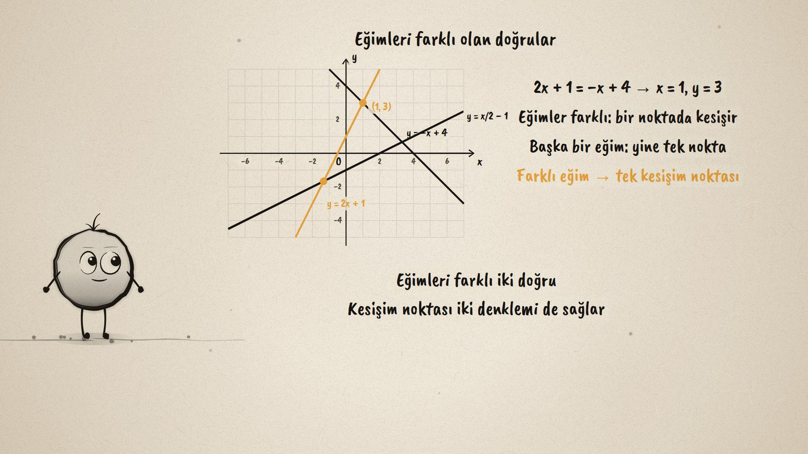
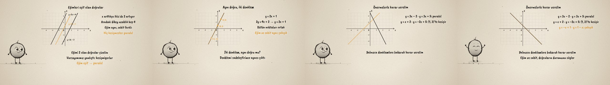

# İki Doğru · Two Lines on the Plane

**▶ Tarayıcıda izleyin / Watch in the browser:** https://hakanatas.github.io/iki-dogru/ 
**⬇ MP4 + altyazılar / MP4 + subtitles:** [Releases](https://github.com/hakanatas/iki-dogru/releases) 
**✎ Kullanılan istem / The prompt behind it:** [PROMPT.md](PROMPT.md) 
**🎞 Bütün filmler / All films:** [Nokta'nın Filmleri](https://hakanatas.github.io/nokta-filmleri/?sinif=8)

> **TR —** 8. sınıf matematik "Cebirsel Düşünme ve Değişimler" temasındaki MAT.8.2.3 öğrenme çıktısı için hazırlanmış, tamamen JavaScript ile çizilen 92 saniyelik mürekkep animasyonu. y = 2x + 1 ve y = 2x − 3 bir yerde kesişir mi? Önce bir varsayım yapılıyor, sonra doğru aileleri inceleniyor. Eğimi 2 olan doğrular aynı hızla yükseliyor, aralarındaki dikey uzaklık değişmiyor: eğimler eşit, sabitler farklıysa doğrular paralel ve varsayım yanlış çıkıyor. Eğimleri farklı doğrular tek noktada kesişiyor: 2x + 1 = −x + 4 ile (1, 3). y = 2x + 1 ile 2y = 4x + 2 ise sadeleşince aynı denklem: çakışık doğrular. Bu önermelerle yeni doğru çiftlerinin durumu grafik çizmeden değerlendiriliyor. Altyazılar Türkçe, İngilizce ya da ikisi birlikte seçilebilir.

A 92-second ink animation for **8th-grade maths**. Nokta, the ink character from [The Learning Ink](https://github.com/hakanatas/the-learning-ink), is the guide again. Every line is `ln(m, b)` in `scenes/scene1.js`, clipped to the grid from its slope and constant, so the pictures of parallel, intersecting and coinciding lines come straight from the two numbers the film asks students to compare.

## Learning outcome

MEB, Türkiye Yüzyılı Maarif Modeli, Ortaokul Matematik, 8th grade, "Cebirsel Düşünme ve Değişimler" theme:

**MAT.8.2.3. Dik koordinat sisteminde iki doğrusal fonksiyonun birbirine göre durumuna ilişkin çıkarım yapabilme**
- a) Dik koordinat sisteminde iki doğrusal fonksiyonun birbirine göre durumuna ilişkin varsayım oluşturur.
- b) Dik koordinat sisteminde farklı doğrusal fonksiyonların birbirlerine göre durumlarını inceleyerek genellemeler yapar.
- c) Genellemeleri ile varsayımlarını karşılaştırır.
- ç) Bulmuş olduğu ilişkilere yönelik önermeler sunar.
- d) Dik koordinat sisteminde verilen doğruların konumlarını değerlendirir.

## Scenes

| # | Time | Scene | What happens | Outcome |
|---|---|---|---|---|
| 1 | 0–10 s | Varsayım | Do y = 2x + 1 and y = 2x − 3 meet? A guess. | a |
| 2 | 10–28 s | Paralel | Equal slopes, different constants: parallel; the guess was wrong. | b, c |
| 3 | 28–46 s | Kesişen | Different slopes meet once: (1, 3). | b |
| 4 | 46–64 s | Çakışık | 2y = 4x + 2 simplifies to y = 2x + 1: the same line. | b, ç |
| 5 | 64–80 s | Karar | Three new pairs judged from their equations. | ç, d |
| 6 | 80–92 s | Aklında kalsın | Parallel, intersecting, coinciding. | a–d |

## Running it

- **Preview:** double-click `index.html` (it works offline).
- **MP4:** run `npm install` once, then `npm run export -- --format=horizontal --captions=tr`.
- **Subtitles and narration:** `npm run srt` writes `out/captions_*.srt` and `narration_notes.txt`.
- **Editing:**
  - Caption text, timings and narration notes: `captions.js`
  - Everything on screen is drawn by `LI.world(t)` in `scenes/scene1.js` (the plane, the lines, the steps, the words); the other scenes only set the camera.
  - Nokta's poses: `src/draw/film.js`; layout for 16:9 and 9:16: `src/draw/kd.js`

It uses the same engine as The Learning Ink: `renderFrame(t)` as a pure function of time, seeded randomness, and frame-by-frame export.
